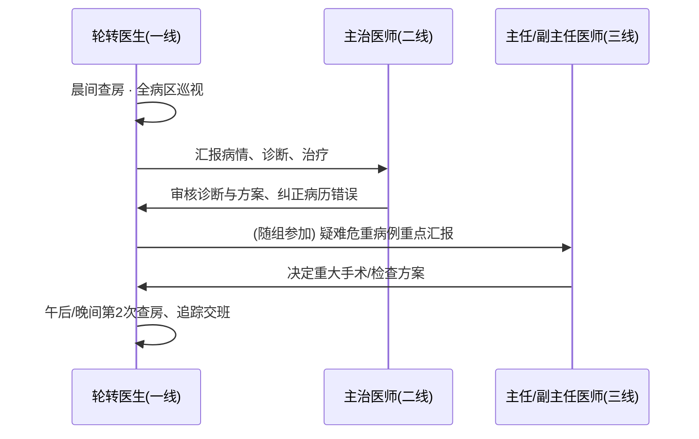

# 轮转医生三级查房制度学习手册

> 依据《首都医科大学附属北京友谊医院核心制度汇编（2026年6月）》之**三级查房制度**整理
>
> 制度定义：患者住院期间，由不同级别医师以查房形式实施**患者评估、制定与调整诊疗方案、观察诊疗效果**的医疗活动制度

---

## 一、三级查房总体框架

| 级别 | 担任人员 | 查房频率 | 病历记录要求 | 核心职责 |
|:---:|:---|:---:|:---:|:---|
| **一线查房** | 住院医师及以上职称 | 每天 ≥2 次 | 随时观察、随时记录；危重至少每日1次病程，平稳每2–3天1次 | **巡视所管全部患者、观察病情、执行追踪医嘱、向上级汇报** |
| **二线查房** | 主治医师及以上职称 | 每周 ≥3 次 | 每周 ≥3 次二线查房记录，单独书写 | **审核诊断与治疗计划、纠正下级病历错误、决定出院转科** |
| **三线查房** | 副主任医师及以上职称或行政科主任 | 每周 ≥2 次 | 每周 ≥2 次三线查房记录，单独书写 | **解决疑难危重、决定重大手术方案、督促科室医疗质量** |

> **资质"就高不就低"原则**：副主任医师/主任医师可代替二线查房（记录注明"××主任（副主任）医师代二线查房记录"）；但**主治医师不能代替三线，住院医师不能代替二线**。

---

## 二、一线查房

### 2.1 频率要求
- **每天对所管患者至少查房 2 次**；
- 因手术、门诊等工作不能亲自查房时，**必须交班给值班的同年资医师**完成，并写好交接；
- **术者必须亲自在术前和术后 24 小时内查房**。

### 2.2 查房内容（制度原文五项）

| 序号 | 内容 | 落地动作 |
|:---:|:---|:---|
| 1 | 巡视查看所管全部患者的症状、体征变化 | 重点关注**危重、疑难、待明确诊断、新入院及术后当天**患者 |
| 2 | 主动向上级医师汇报经治病人的病情、诊断、治疗 | 汇报有重点、有数据，先讲变化和新问题 |
| 3 | 检查当日开具医嘱的执行情况、辅助检查完成情况 | 开出去的医嘱要闭环，不能"开完就走" |
| 4 | 追踪检查化验结果回报，给予及时处理 | 危急值立即按流程上报处理并记录 |
| 5 | 检查患者饮食情况及心理状态，征求患者对饮食、生活意见 | 关注主诉之外的"人"，也是病情信息来源 |

### 2.3 记录要求
- 随时观察、随时记录；危重至少每日1次病程，平稳每2–3天1次；
- 上级医师查房记录**不能替代**一线自己的查房记录。

---

## 三、二线查房

### 3.1 频率与人员
- **每周至少 3 次**（不能亲自完成时，交班给值班同年资医师）；
- 参加人员：**本组住院医师、进修医师、实习医生**——轮转医生必须参加。

### 3.2 查房内容
- **系统查房**：对所管区域全部患者进行系统查房，重点针对新入院、危重、诊断未明、治疗效果欠佳患者；
- **审核把关**：审核诊断、鉴别诊断、治疗计划和前期治疗效果；补充病史及体格检查；**检查下级医师书写的病历并纠正错误**；
- **方案制定**：提出手术及特殊检查治疗方案，报上级医师确定；
- **医嘱与疗效**：检查医嘱执行情况，评价治疗效果；
- **决策权限**：决定提交三线查房、全科讨论及全院 MDT 的疑难病例；
- **患者沟通**：了解病情变化，征求患者对饮食、生活的意见；
- **教学**：三基三严培训及必要教学工作。

### 3.3 轮转医生在二线查房中的配合
- 提前备齐病历、影像片、检查报告、查体用品；
- 报告简要病历、当前病情及**需要解决的问题**；
- 对二线医师纠正的病历错误**当场修改、及时复签**；
- 二线指示落实后写入病程记录。

---

## 四、三线查房

### 4.1 频率与人员
- **每周至少 2 次**；**住院时间少于 1 周者，出院前必须有 1 次三线查房**；
- 参加人员：**本组各级医师、进修医师、实习医生**，必要时邀请科室负责的临床药师参与——轮转医生必须参加。

### 4.2 查房内容
- **重点指导**：查看指导疑难、危重病例及新入院患者的诊断、治疗计划；
- **重大决策**：**决定重大手术及特殊检查治疗方案**；
- **质量管理**：督促医疗质量管理；检查病案质量；
- **教学培训**：三基三严培训及必要的教学工作；

### 4.3 轮转医生在三线查房中的配合
- 将二线要求"提交三线"的病例资料准备完整（病史、检查、治疗经过、待解决的问题）；
- 三线指示**单独记录于三线查房记录**，并及时在病程中体现执行；
- 对三线决定的重大手术/检查方案，负责完善术前准备并追踪落实。

---

## 六、每日查房流程（Mermaid 时序图）

---

